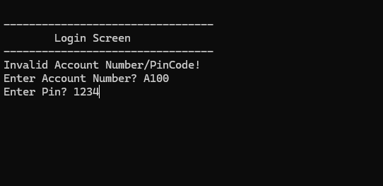
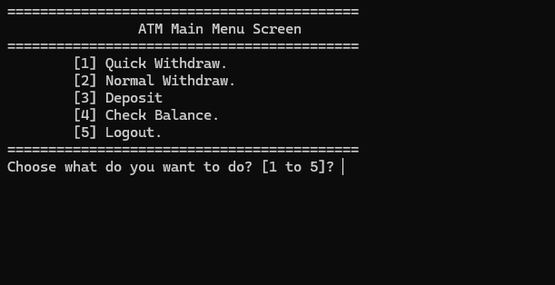
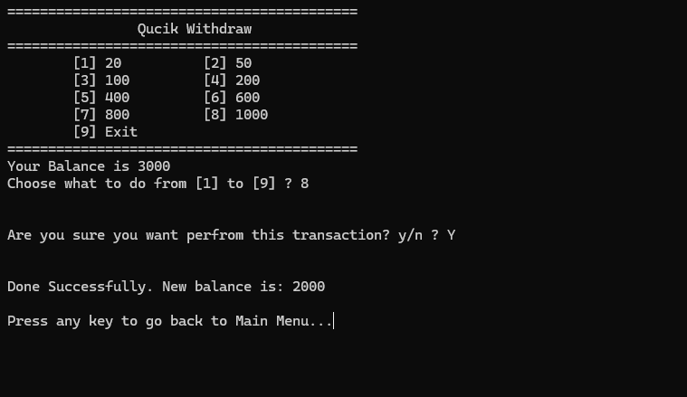

# ATM System - C++

## Description

My fourth project as a developer: a simple C++ ATM application built using procedural programming.

## Features

- **Client Authentication:** Log in using an account number and PIN code.
- **Quick Withdraw:** Choose from predefined withdrawal amounts.
- **Normal Withdraw:** Enter a custom withdrawal amount (must be a multiple of 5).
- **Deposit:** Deposit money into the current account.
- **Balance Inquiry:** View the current account balance.
- **Data Persistence:** Store and update client information using text files.
- **Transaction Confirmation:** Confirm deposits and withdrawals before processing them.

## Screenshots







## Technologies Used

- C++
- Standard Template Library (STL)
- File Handling (`fstream`)
- Visual Studio

## Concepts Demonstrated

- Procedural Programming
- Functions and Function Decomposition
- Structures (`struct`)
- Enumerations (`enum`)
- Vectors (`vector`)
- File Handling and Data Persistence
- Reading and Writing Text Files
- String Manipulation
- Data Serialization and Deserialization
- Pass by Reference
- Conditional Statements and Loops
- Switch Statements

## Data Storage

The application uses a text file (`Clients.txt`) to store client information, including account numbers, PIN codes, names, phone numbers, and account balances.

The repository includes a sample `Clients.txt` file to make it easier to run and explore the application.

## How It Works

1. The user logs in using their account number and PIN code.
2. After successful authentication, the ATM main menu is displayed.
3. The user can perform withdrawals, deposits, or check their balance.
4. Transactions are confirmed before being processed.
5. Updated account information is saved back to `Clients.txt`.

## How to Run

1. Clone the repository:

   ```bash
   git clone https://github.com/HeshamSallem510/ATM-System-CPP.git
   ```

2. Open the solution file in Visual Studio.
3. Build and run the project.
4. Use one of the sample accounts provided in `Clients.txt` to log in.

> The current implementation uses Windows-specific console commands, including `system("cls")` and `system("pause>0")`, so it is intended for Windows.

## Author

**Hesham Sallem**

